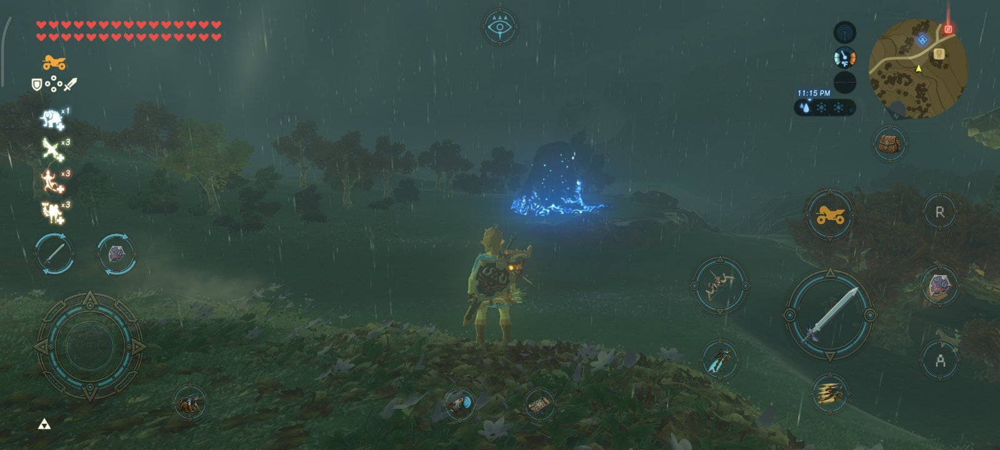
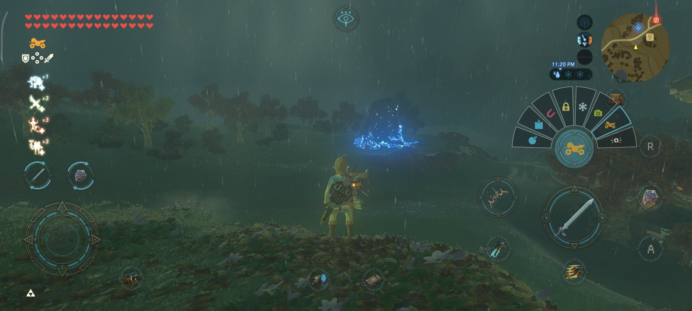

# BOTWRecompAndroid

**English** | [Português](README.pt-BR.md)

[](https://playported.com/ports/754-the-legend-of-zelda-breath-of-the-wild/)

A port of *The Legend of Zelda: Breath of the Wild* (Nintendo Switch, versions **1.0.0, 1.6.0, 1.8.2 and 1.9.0**) for
Android. This is **not Switch emulation**: the game code can be recompiled into C for the phone or, in the experimental
Native Mode, run directly on its ARM64 CPU. The game's graphics API (NVN) is translated to Vulkan.

It is built on the engine of **[LAS Recomp](https://github.com/peiikai/LASRecomp)** by peiikai (a recompilation of
*Link's Awakening*) and its Android port, **[LASRecompAndroid](https://github.com/mamcjr/LASRecompAndroid)**.

> [!WARNING]
> **Beta.** Tested primarily on one phone (POCO F7 Ultra, Adreno 830, Mesa Turnip driver). Performance and compatibility
> vary by device; expect bugs, especially on GPUs that have not been tested on physical hardware. See the
> [0.3.1-beta release notes](https://github.com/mamcjr/BOTWRecompAndroid/releases/tag/v0.3.1-beta) and the
> [development notes](docs/BOTW-PORT.md) (in Portuguese).

## Supported platform

Android is the only application target. Desktop ports and packaging were discontinued on 2026-10-22.
Windows, Linux or macOS may still be used as development hosts with the Android SDK/NDK.

## Status

- **Playable** from the title screen into the world, with saves, on the tested POCO F7 Ultra. All four listed game
  versions are supported in Recompiled Mode. Native Mode has been tested with 1.0.0 and 1.9.0; 1.6.0 and 1.8.2 still
  need testing in that mode.
- **Game code:** choose Recompiled Mode (build the code once on the phone) or experimental Native Mode (skip that
  build). You can switch a Recompiled setup to Native Mode later.
- **Game files:** copy the extracted files into app storage or, since **0.2.3-beta**, use them in place without an
  additional copy of about 16 GB. In-place use requires Android all-files access and the source folder must remain
  available.
- **DLC, saves and mods:** install your own extracted Expansion Pass data; import and export saves as ZIP or import an
  emulator save folder; use mods, including mods that add files and DLC mod folders. In-place mod use needs more testing.
- **Video and controls:** optional 60 fps on supported game versions and experimental 60 fps in-engine cutscenes,
  unlocked aspect ratio, internal/output resolution, FSR 1 or Snapdragon GSR 1 upscaling, FXAA/SMAA, touch controls,
  physical controllers and gyro. The app offers a Vulkan driver selector and compatibility settings.
- **0.3.0:** crashes and freezes after 30+ minutes on Mali GPUs, the fast travel's dissolve, stray leaves on the
  ground, the stable's windows and the loading screens in unlocked aspect, a 40 / 45 fps frame rate, even 30 fps on
  60 Hz screens, touch buttons for the arrows and the album, and two Driver compatibility options: the driver's own
  variables, and game memory through a shared file for Mali and Xclipse (experimental).
- **Known issues:** short grass appears only up close; water reflections can move with the camera; the pause menu
  background can be black on Qualcomm's stock driver; Link may flicker on the first hit in Native Mode; rain falls
  slower than on the console.

> [!IMPORTANT]
> Like LAS Recomp, this project is made almost entirely with AI (Claude, by Anthropic, through Claude Code), directed,
> tested and reviewed by a human.

> [!NOTE]
> **No game files or DLC are included.** You need your own legally obtained, extracted game files (`exefs` and
> `romfs`). The app does not open NSP/XCI files or use `prod.keys`. Instructions on obtaining game files are not
> provided.

## Touch Controls Overhaul

Since **0.2.12-beta**, the touch controls show what each button does while you play in the world, with the game's own
icons read from your game files. The game's menus keep the classic buttons.



- **Your gear on the buttons:** attack, the bow and the shield show what you have equipped, and power shows the selected
  rune (1.6.0, 1.8.2 and 1.9.0).
- **Rune fan:** tap power to use the rune; hold it to open a fan of your runes and let go over the one you want.
- **Gestures:**
  - **Bow and throw:** hold and drag the same finger to aim (with motion controls on, move the phone instead); its sensitivity is in Controls.
    While you hold them, a ✕ cancels the shot or the throw; with the bow drawn, an arrow button picks the arrows.
  - **Parry:** slide the finger on the held shield.
  - **Magnesis and the camera:** with Magnesis selected, a d-pad cross moves the object; with the camera rune, a − button
    opens the album.
  - **Camera:** drag anywhere on the right half.
  - **Weapon and shield pickers:** hold, then choose with a second finger.
  - **Shield surfing:** double-tap the shield and hold.
- **Minimap at the top:** while the touch controls are on screen, the minimap, time, temperature and sensor move to the
  top right corner. With a controller they stay in their usual place. Double-tap the minimap to open the map; the Sheikah Slate
  button opens the scope.
- **Your own layout:** in **Controls**, edit the action layout or the classic one. Drag the buttons, and select one to
  make it bigger or smaller with **−** and **+**.



## Installing (beta)

1. Download the APK from [Releases](https://github.com/mamcjr/BOTWRecompAndroid/releases) and install it (Android 11+,
   ARM64 and Vulkan). You need your own extracted game folder containing `exefs` and `romfs`.
2. In **Game Files**, choose **Game code**: **Native (experimental)** skips the on-phone code build; **Recompiled**
   builds it once. Under **Game files**, choose **Copy them** or **Use them in place**, then select the extracted folder.
   In-place use asks for Android all-files access; keep that folder where it is. Copying needs roughly 16 GB more
   storage for the game data, while Recompiled Mode also needs space for generated code.
3. If you own the Expansion Pass, install its extracted DLC `romfs` through **Settings > DLC > Install DLC**. To bring
   over saves, use **Settings > Saves** to import a ZIP or emulator save folder.
4. On Adreno phones, a Mesa Turnip driver can perform better than the system driver. Select it under **Settings >
   Files > Vulkan driver**. If the app reports that the Vulkan driver is too old at startup, long-press the app icon
   and choose **Choose driver** before launching the game.

Updating from 0.2.x to 0.3.1-beta does not require rebuilding game code. Shaders compile again once, so the first
minutes may stutter. To report a problem, open an [issue](https://github.com/mamcjr/BOTWRecompAndroid/issues) with
your phone, GPU, driver, game version and a log from **Settings > Files > Save a log file**.

## Testing on Android (developers)

With the Android SDK / NDK, a phone on adb and your dump in `Dump/`:

```bash
cd android/botwrecompandroid && ./gradlew assembleDebug    # the app
android/build_gamelib.sh Dump/01007EF00011E000/exefs  # the game code (about an hour)
android/push_game.sh Dump/01007EF00011E000           # game files and game code onto the phone
android/run_boot.sh 120                               # start the game, log to android/out/boot.log
```

## Support the project

BOTWRecompAndroid is a free, independent project. If you enjoy it and would like to support its development, you can
sponsor me on GitHub. Your support helps me dedicate time to fixing bugs, improving performance and compatibility, and
working on future releases. Sponsorship is entirely optional: it does not unlock features or guarantee specific fixes.
Bug reports, device tests, and contributions are also greatly appreciated.

[](https://github.com/sponsors/mamcjr)

## Credits

- [peiikai](https://github.com/peiikai) for [LAS Recomp](https://github.com/peiikai/LASRecomp), the recompiler and
  runtime this project starts from (MIT, see [LICENSE](LICENSE)). The original README is kept in [docs/las/](docs/las/).
- [LASRecompAndroid](https://github.com/mamcjr/LASRecompAndroid), its Android port: the app, the phone-side game code
  build, touch controls, mods, driver compatibility and the Portuguese menus.
- [Revivedx](https://github.com/Revivedx) for [SavageWindRecomp](https://github.com/Revivedx/SavageWindRecomp) (MIT),
  the reference for 1.8.2: frame pacing, internal resolution, the SDK 20 kernel fixes, setjmp.
- [Nycolazs](https://github.com/Nycolazs) for LASRecomp-Android-Plus (MIT): Vulkan driver compatibility.
- [ly05010419](https://github.com/ly05010419) for [MacNativeGames](https://github.com/ly05010419/MacNativeGames) (MIT),
  whose fixes and notes for BOTW and TOTK pointed the way for several here: the sync lag (its PR #680), GPU results
  the CPU reads back (PR #239), the terrain's height map texture (PR #511), texture layout, and the gyroscope's drift;
  and for showing that the game's own ARM64 code can run directly (Native game code).
- [OJZen](https://github.com/OJZen) for [totk-mobile](https://github.com/OJZen/totk-mobile), and
  [jhaizhou-ops](https://github.com/jhaizhou-ops) for [d2r-mobile](https://github.com/jhaizhou-ops/d2r-mobile), the
  core it builds on: what the native mode rewrites in the game's code (`svc`, the thread registers, the counter) and
  how - the idea behind ours (no code taken).
- The [zeldaret/botw](https://github.com/zeldaret/botw) decompilation and [open-ead/sead](https://github.com/open-ead/sead),
  for what is known about the game's code.
- Dusklight's launcher, the start screen's style.
- Upscaling and anti-aliasing: [AMD FidelityFX FSR 1](https://github.com/GPUOpen-Effects/FidelityFX-FSR) (MIT),
  [Qualcomm Snapdragon GSR](https://github.com/SnapdragonStudios/snapdragon-gsr) (BSD-3-Clause),
  [SMAA](https://github.com/iryoku/smaa) (MIT).
- Libraries: [SDL](https://libsdl.org) (zlib), [Dear ImGui](https://github.com/ocornut/imgui) (MIT),
  [libadrenotools](https://github.com/bylaws/libadrenotools) (BSD-2-Clause), [volk](https://github.com/zeux/volk) (MIT),
  [Vulkan Memory Allocator](https://github.com/GPUOpen-LibrariesAndSDKs/VulkanMemoryAllocator) (MIT),
  [shaderc](https://github.com/google/shaderc) (Apache 2.0), [FFmpeg](https://ffmpeg.org) (LGPL),
  [LZ4](https://github.com/lz4/lz4) (BSD-2-Clause), [Capstone](https://www.capstone-engine.org) (BSD-3-Clause),
  [Unicorn](https://www.unicorn-engine.org) (GPLv2, built from its source by `android/deps/build_unicorn.sh`),
  [Python](https://www.python.org) (PSF) and [Zig](https://ziglang.org) (MIT) for the phone-side build.
- [Mesa](https://www.mesa3d.org)'s Turnip driver (MIT), which players load themselves.
- Fonts: [Baloo 2](https://github.com/EkType/Baloo2) (OFL), DejaVu Sans (Bitstream Vera license). The Android robot
  is reproduced or modified from work created and shared by Google (CC BY 3.0).
- Contributions through pull requests:
  - [3122380113](https://github.com/3122380113): builds without FFmpeg again
    ([#97](https://github.com/mamcjr/BOTWRecompAndroid/pull/97)); sound that came back silent after the app sat in the
    background ([#96](https://github.com/mamcjr/BOTWRecompAndroid/pull/96)).
  - [todwang96](https://github.com/todwang96): the GPU heap kept on for Adreno 7xx under Turnip, blank text otherwise
    ([#103](https://github.com/mamcjr/BOTWRecompAndroid/pull/103)).
  - [Ureta93](https://github.com/Ureta93): settings files saved with Windows line endings
    ([#187](https://github.com/mamcjr/BOTWRecompAndroid/pull/187)).
  - [Propinbo](https://github.com/Propinbo): Link breaking up into light again on a fast travel, instead of turning flat
    blue and vanishing ([#210](https://github.com/mamcjr/BOTWRecompAndroid/pull/210)); 30 fps frames shown evenly on
    60 Hz screens, no more 50 / 16.7 ms judder ([#183](https://github.com/mamcjr/BOTWRecompAndroid/pull/183)).
- Made with [Claude Code](https://claude.com/claude-code) (Anthropic).

*The Legend of Zelda* and *Breath of the Wild* are trademarks of Nintendo. This project is not affiliated with or
endorsed by Nintendo.
