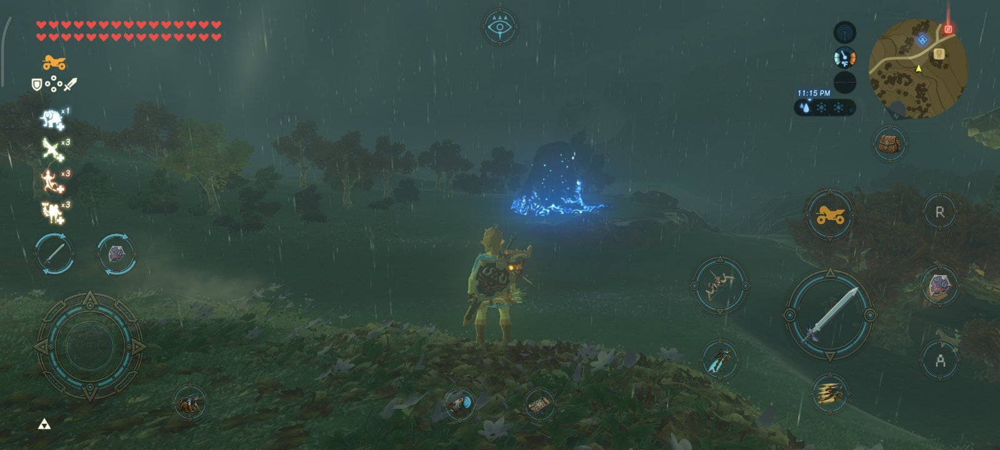
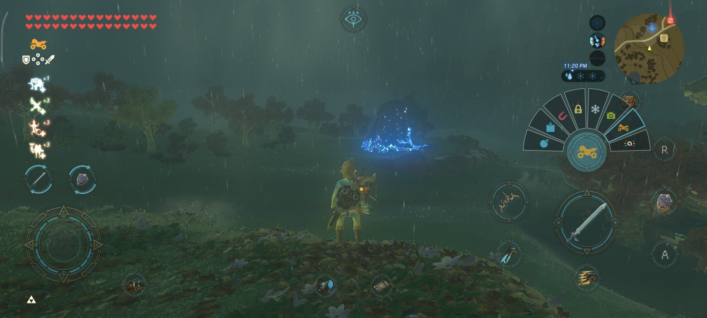

# BOTWRecompAndroid

[English](README.md) | **Português**

[](https://playported.com/ports/754-the-legend-of-zelda-breath-of-the-wild/)

Um porte de *The Legend of Zelda: Breath of the Wild* (Nintendo Switch, versões **1.0.0, 1.6.0, 1.8.2 e 1.9.0**) para
Android. **Não é emulação do Switch**: o código do jogo pode ser recompilado em C para o celular ou, no modo nativo
experimental, executado diretamente na CPU ARM64. A API gráfica do jogo (NVN) é traduzida para Vulkan.

O projeto parte do motor do **[LAS Recomp](https://github.com/peiikai/LASRecomp)**, de peiikai (uma recompilação de
*Link's Awakening*), e do seu porte para Android, o **[LASRecompAndroid](https://github.com/mamcjr/LASRecompAndroid)**.

> [!WARNING]
> **Beta.** Testado principalmente em um celular (POCO F7 Ultra, Adreno 830, driver Mesa Turnip). O desempenho e a
> compatibilidade variam entre aparelhos; espere bugs, sobretudo em GPUs ainda não testadas fisicamente. Veja as
> [notas da 0.3.1-beta](https://github.com/mamcjr/BOTWRecompAndroid/releases/tag/v0.3.1-beta) e as
> [notas de desenvolvimento](docs/BOTW-PORT.md).

## Plataforma suportada

Android é o único alvo do aplicativo. Os ports e pacotes desktop foram descontinuados em 2026-10-22.
Windows, Linux e macOS podem continuar sendo usados como ambientes de desenvolvimento com o Android SDK/NDK.

## Estado

- **Jogável** da tela de título até o mundo, com saves, no POCO F7 Ultra testado. As quatro versões listadas são
  suportadas no modo recompilado. O modo nativo foi testado com 1.0.0 e 1.9.0; 1.6.0 e 1.8.2 ainda precisam de testes
  nesse modo.
- **Código do jogo:** escolha o modo Recompilado (compila o código uma vez no celular) ou Nativo experimental (dispensa
  essa compilação). Quem configurou o modo Recompilado pode alternar para o Nativo depois.
- **Arquivos do jogo:** copie os dados extraídos para a pasta do app ou, desde a **0.2.3-beta**, use-os no lugar, sem
  uma cópia extra de cerca de 16 GB. Usar no lugar exige acesso a todos os arquivos do Android, e a pasta original
  precisa continuar disponível.
- **DLC, saves e mods:** instale os dados extraídos do seu Passe de Expansão; importe ou exporte saves em ZIP ou importe
  uma pasta de saves de emulador; use mods, inclusive os que adicionam arquivos e pastas de mod do DLC. O uso de mods
  no lugar ainda precisa de mais testes.
- **Vídeo e controles:** opção de 60 fps nas versões do jogo compatíveis e cutscenes a 60 fps experimentais,
  proporção livre da tela, resoluções interna e de saída, upscaling FSR 1 ou Snapdragon GSR 1, FXAA/SMAA, controles de
  toque e físicos e giroscópio. O app oferece escolha de driver Vulkan e opções de compatibilidade.
- **0.3.0:** crashes e travamentos depois de 30+ minutos nas GPUs Mali, a dissolução da viagem rápida, folhas
  surgindo no chão, as janelas do estábulo e as telas de carregamento na proporção livre, taxa de 40 / 45 fps, 30 fps
  uniformes em telas de 60 Hz, botões de toque para as flechas e o álbum, e duas opções em Compatibilidade do driver:
  as variáveis do próprio driver e a memória do jogo por arquivo compartilhado para Mali e Xclipse (experimental).
- **Problemas conhecidos:** a grama baixa só aparece de perto; reflexos da água podem acompanhar a câmera; o fundo
  do menu de pausa pode ficar preto no driver padrão da Qualcomm; Link pode piscar no primeiro golpe no modo nativo;
  a chuva cai mais devagar que no console.

> [!IMPORTANT]
> Como o LAS Recomp, este projeto é feito quase todo com IA (Claude, da Anthropic, pelo Claude Code), dirigido,
> testado e revisado por um humano.

> [!NOTE]
> **Nenhum arquivo do jogo ou DLC vem incluído.** Você precisa dos seus próprios arquivos do jogo, obtidos legalmente
> e extraídos (`exefs` e `romfs`). O app não abre NSP/XCI nem usa `prod.keys`. Não serão dadas instruções de como
> obter os arquivos.

## Touch Controls Overhaul

Desde a **0.2.12-beta**, enquanto você joga no mundo, os controles de toque mostram o que cada botão faz, com os
ícones do próprio jogo lidos dos seus arquivos. Os menus do jogo continuam com os botões clássicos.



- **Seu equipamento nos botões:** o ataque, o arco e o escudo mostram o que está equipado, e o poder mostra a runa
  selecionada (1.6.0, 1.8.2 e 1.9.0).
- **Leque de runas:** toque no poder para usar a runa; segure para abrir um leque com as suas runas e solte sobre a que
  quiser.
- **Gestos:**
  - **Arco e arremessar:** segure e arraste o mesmo dedo para mirar (com o controle por movimento ligado, mova o celular); a sensibilidade fica em Controles.
    Enquanto segura, um ✕ cancela o tiro ou o arremesso; com o arco puxado, um botão de flechas troca as flechas.
  - **Parry:** deslize o dedo sobre o escudo erguido.
  - **Magnésis e câmera:** com a Magnésis selecionada, uma cruz direcional move o objeto; com a runa da câmera, um
    botão − abre o álbum.
  - **Câmera:** arraste em qualquer ponto da metade direita.
  - **Troca de arma e de escudo:** segure e escolha com um segundo dedo.
  - **Surf com escudo:** toque duas vezes no escudo e segure.
- **Minimapa no alto:** com os controles de toque na tela, o minimapa, a hora, a temperatura e o sensor vão para o
  canto superior direito. Com um controle, ficam no lugar de sempre. Toque duas vezes no minimapa para abrir o mapa; o botão da
  Sheikah Slate abre a luneta.
- **Seu próprio layout:** em **Controles**, edite o layout de ação ou o clássico. Arraste os botões, e selecione um
  para aumentá-lo ou diminuí-lo com **−** e **+**.



## Instalando (beta)

1. Baixe o APK em [Releases](https://github.com/mamcjr/BOTWRecompAndroid/releases) e instale (Android 11+, ARM64 e
   Vulkan). Tenha a sua própria pasta extraída com `exefs` e `romfs`.
2. Em **Arquivos do jogo**, escolha **Código do jogo**: **Nativo (experimental)** dispensa a compilação no celular;
   **Recompilado** compila uma vez. Em **Arquivos do jogo**, escolha **Copiar** ou **Usar no lugar** e selecione a pasta
   extraída. Usar no lugar pede acesso a todos os arquivos do Android; mantenha a pasta no mesmo local. Copiar exige
   cerca de 16 GB adicionais para os dados do jogo, e o modo Recompilado também precisa de espaço para o código gerado.
3. Se você possui o Passe de Expansão, instale o `romfs` extraído do DLC em **Configurações > DLC > Instalar DLC**.
   Para trazer saves, use **Configurações > Saves** para importar um ZIP ou uma pasta de saves de emulador.
4. Em celulares com Adreno, um driver Mesa Turnip pode ter desempenho melhor que o driver do sistema. Selecione-o em
   **Configurações > Arquivos > Driver Vulkan**. Se o app informar que o driver Vulkan é antigo ao abrir, toque e
   segure o ícone do app e escolha **Escolher driver** antes de iniciar o jogo.

Atualizar da 0.2.x para a 0.3.1-beta não exige recompilar o código do jogo. Os shaders são compilados novamente uma
vez, então os primeiros minutos podem ter travadinhas. Para relatar um problema, abra uma
[issue](https://github.com/mamcjr/BOTWRecompAndroid/issues) com celular, GPU, driver, versão do jogo e um log de
**Configurações > Arquivos > Salvar um arquivo de log**.

## Testando no Android (desenvolvedores)

Com o Android SDK / NDK, um celular no adb e o seu dump em `Dump/`:

```bash
cd android/botwrecompandroid && ./gradlew assembleDebug    # o app
android/build_gamelib.sh Dump/01007EF00011E000/exefs  # o código do jogo (cerca de uma hora)
android/push_game.sh Dump/01007EF00011E000           # arquivos e código do jogo para o celular
android/run_boot.sh 120                               # abre o jogo, log em android/out/boot.log
```

## Apoie o projeto

O BOTWRecompAndroid é um projeto gratuito e independente. Se você gosta dele e quer apoiar seu desenvolvimento, pode
me patrocinar pelo GitHub. Esse apoio me ajuda a dedicar tempo à correção de bugs, à melhoria do desempenho e da
compatibilidade e às próximas versões. O patrocínio é totalmente opcional: não libera recursos exclusivos nem garante
correções específicas. Relatos de bugs, testes em outros aparelhos e contribuições também ajudam muito.

[](https://github.com/sponsors/mamcjr)

## Créditos

- [peiikai](https://github.com/peiikai), pelo [LAS Recomp](https://github.com/peiikai/LASRecomp), o recompilador e o
  runtime de onde este projeto parte (MIT, ver [LICENSE](LICENSE)). O README original fica em [docs/las/](docs/las/).
- [LASRecompAndroid](https://github.com/mamcjr/LASRecompAndroid), o porte dele para Android: o app, a compilação do
  código do jogo no celular, os controles de toque, os mods, a compatibilidade do driver e os menus em português.
- [Revivedx](https://github.com/Revivedx), pelo [SavageWindRecomp](https://github.com/Revivedx/SavageWindRecomp) (MIT),
  a referência para a 1.8.2: ritmo de quadros, resolução interna, as correções do kernel do SDK 20, setjmp.
- [Nycolazs](https://github.com/Nycolazs), pelo LASRecomp-Android-Plus (MIT): compatibilidade de drivers Vulkan.
- A decompilação [zeldaret/botw](https://github.com/zeldaret/botw) e o [open-ead/sead](https://github.com/open-ead/sead),
  pelo que se sabe do código do jogo.
- O launcher do Dusklight, o estilo da tela inicial.
- Upscaling e anti-aliasing: [AMD FidelityFX FSR 1](https://github.com/GPUOpen-Effects/FidelityFX-FSR) (MIT),
  [Qualcomm Snapdragon GSR](https://github.com/SnapdragonStudios/snapdragon-gsr) (BSD-3-Clause),
  [SMAA](https://github.com/iryoku/smaa) (MIT).
- Bibliotecas: [SDL](https://libsdl.org) (zlib), [Dear ImGui](https://github.com/ocornut/imgui) (MIT),
  [libadrenotools](https://github.com/bylaws/libadrenotools) (BSD-2-Clause), [volk](https://github.com/zeux/volk) (MIT),
  [Vulkan Memory Allocator](https://github.com/GPUOpen-LibrariesAndSDKs/VulkanMemoryAllocator) (MIT),
  [shaderc](https://github.com/google/shaderc) (Apache 2.0), [FFmpeg](https://ffmpeg.org) (LGPL),
  [LZ4](https://github.com/lz4/lz4) (BSD-2-Clause), [Capstone](https://www.capstone-engine.org) (BSD-3-Clause),
  [Unicorn](https://www.unicorn-engine.org) (GPLv2, compilado do código-fonte por `android/deps/build_unicorn.sh`),
  [Python](https://www.python.org) (PSF) e [Zig](https://ziglang.org) (MIT) para a compilação no celular.
- O driver Turnip do [Mesa](https://www.mesa3d.org) (MIT), que os jogadores carregam por conta própria.
- Fontes: [Baloo 2](https://github.com/EkType/Baloo2) (OFL), DejaVu Sans (licença Bitstream Vera). O robô do Android
  é reproduzido ou modificado a partir de trabalho criado e compartilhado pelo Google (CC BY 3.0).
- Contribuições por pull request:
  - [3122380113](https://github.com/3122380113): a compilação sem FFmpeg de volta
    ([#97](https://github.com/mamcjr/BOTWRecompAndroid/pull/97)); o som que voltava mudo depois de o app ficar em
    segundo plano ([#96](https://github.com/mamcjr/BOTWRecompAndroid/pull/96)).
  - [todwang96](https://github.com/todwang96): o heap da GPU ligado no Adreno 7xx com o Turnip, sem ele o texto ficava em
    branco ([#103](https://github.com/mamcjr/BOTWRecompAndroid/pull/103)).
  - [Ureta93](https://github.com/Ureta93): arquivos de configuração salvos com quebras de linha do Windows
    ([#187](https://github.com/mamcjr/BOTWRecompAndroid/pull/187)).
  - [Propinbo](https://github.com/Propinbo): o Link volta a se desfazer em luz na viagem rápida, em vez de ficar azul
    chapado e sumir ([#210](https://github.com/mamcjr/BOTWRecompAndroid/pull/210)); quadros de 30 fps exibidos por igual
    em telas de 60 Hz, sem o tranco de 50 / 16,7 ms ([#183](https://github.com/mamcjr/BOTWRecompAndroid/pull/183)).
- Feito com o [Claude Code](https://claude.com/claude-code) (Anthropic).

*The Legend of Zelda* e *Breath of the Wild* são marcas da Nintendo. Este projeto não é afiliado nem endossado pela
Nintendo.
